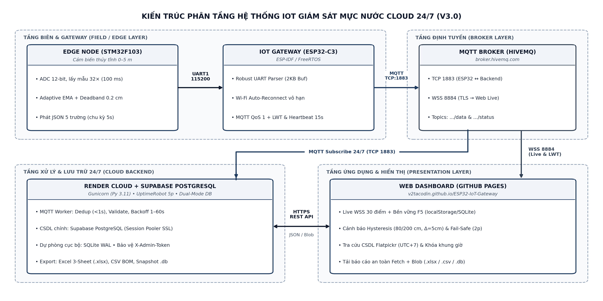
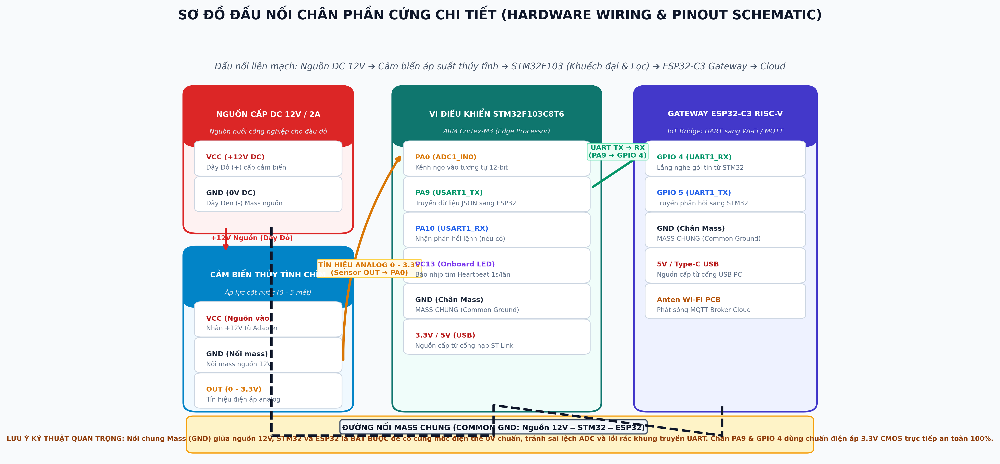

# ESP32-IoT-Gateway — Hệ Thống Giám Sát Mực Nước Thủy Văn IoT

> **Hệ thống IoT 4 tầng giám sát mực nước thủy văn thời gian thực (0 – 500 cm), kết hợp STM32F103C8T6, ESP32-C3 SuperMini, MQTT (HiveMQ), Backend Python (Render), Cơ sở dữ liệu vĩnh viễn PostgreSQL (Supabase) và Web Dashboard (GitHub Pages).**

[](https://v2tacodin.github.io/ESP32-IoT-Gateway/)
[](https://esp32-iot-gateway.onrender.com/api/status)
[](#bản-quyền--nhóm-thực-hiện)

---

## 🌟 Tổng quan kiến trúc hệ thống (4 tầng)

Hệ thống tách biệt rõ ràng giữa nút đo cảm biến, cổng truyền thông không dây, máy chủ xử lý/lưu trữ đám mây và giao diện hiển thị:

1. **Tầng 1 — Edge Sensing Node (`STM32F103C8T6`):**
   - Đọc cảm biến áp suất thủy tĩnh thả chìm dải đo **0 – 5 m (0 – 500 cm)**, tín hiệu tuyến tính **0.12 V – 3.30 V** qua chân **ADC 12-bit (`PA0` / `ADC1_IN0`)** có tự hiệu chuẩn phần cứng (`HAL_ADCEx_Calibration_Start`).
   - Áp dụng **bộ lọc số 3 tầng** (lấy mẫu mỗi `100 ms`):
     1. *Oversampling trung bình 32 mẫu* khử nhiễu trắng ADC.
     2. *Adaptive EMA* (bám nhanh `80%` khi biến động `> 2.0 cm`; lọc mượt `15%` khi dao động nhỏ để triệt sóng nước).
     3. *Deadband `0.2 cm`* chống rung số thập phân.
   - Áp dụng chuẩn **Live-Zero (`0.12 V`)** giúp phát hiện ngay sự cố đứt dây / mất nguồn cảm biến (`< 0.08 V`).
   - Quy đổi áp suất thủy tĩnh theo công thức $P_{\text{Bar}} = h / 1019.72$ và gửi khung **JSON** không chặn (*non-blocking*) mỗi **5 giây** qua `USART1 (115200 8N1)`, đồng thời nháy LED `PC13`.

2. **Tầng 2 — Wireless IoT Gateway (`ESP32-C3 SuperMini` — ESP-IDF + FreeRTOS):**
   - Chạy FreeRTOS Task `uart_rx_task` với bộ đệm vòng `2048 bytes` và kỹ thuật *Delimiter-based Framing* (`{ ... }\n`) chống cắt vỡ khung JSON và lọc byte rác đầu dòng.
   - Duy trì kết nối Wi-Fi 2.4 GHz (Station Mode) với cơ chế **Auto-Reconnect vô hạn**.
   - Xuất bản dữ liệu lên **HiveMQ Broker** qua **MQTT (QoS 1)** trên topic `my_iot_project/stm32_sensor_data`.
   - Hỗ trợ **Keepalive 15 giây**, **Last Will & Testament (LWT)** phát trạng thái `offline` tức thì khi mất nguồn, và **Heartbeat 15 giây** báo cáo bộ đếm `uart_rx` / `mqtt_pub` để chẩn đoán lỗi từng chặng.

3. **Tầng 3 — Cloud Broker, Backend & Database (`HiveMQ` + `Render` + `Supabase`):**
   - **Backend Python (`Flask` + `Gunicorn gthread` + `MQTT Background Worker`)** triển khai trên **Render Cloud** (duy trì hoạt động 24/7 bằng `UptimeRobot` ping `HEAD /api/status` mỗi 5 phút).
   - **Kiến trúc CSDL đa chế độ (`DualDBConnection`):** tự động kết nối **PostgreSQL (Supabase, SSL)** khi có biến môi trường `DATABASE_URL` để lưu trữ vĩnh viễn trên Cloud, hoặc tự fallback sang **SQLite (WAL mode)** khi chạy cục bộ trên PC.
   - Tích hợp lọc trùng tin `< 1s`, kiểm duyệt JSON (chặn `NaN/Inf`, kiểm tra `0 <= raw_adc <= 4095`), tự kết nối lại MQTT theo *Exponential Backoff (1s → 60s)*, **Downsampling** (`> 1500` điểm tự gom về `~800` điểm), **Gap Detection** (ngắt nét vẽ khi mất dữ liệu) và xuất báo cáo `.xlsx` / `.csv` (UTF-8 BOM) / `.db`.

4. **Tầng 4 — Web Dashboard (`GitHub Pages`):**
   - Hoạt động song song 2 kênh: nhận dữ liệu **Realtime** trực tiếp qua **MQTT over WSS (Port 8884)** và truy vấn **Lịch sử / Thống kê / Xuất báo cáo** qua **REST API** tới Render.
   - Cảnh báo 3 ngưỡng mực nước (mặc định: Bình thường `< 80 cm`, Cảnh báo `≥ 80 cm`, Nguy hiểm `≥ 200 cm`) và cảnh báo **Lỗi điện áp / Đứt cảm biến** (`< 0.08 V`).
   - Hỗ trợ lọc theo 1 ngày hoặc khoảng ngày + khung giờ (**UTC+7**), phân trang và tải file trực tiếp.

---

## 🏗️ Sơ đồ kiến trúc & Luồng dữ liệu

```text
[Cảm biến áp suất 0–5m]
     │ (0.12V – 3.30V -> PA0)
     ▼
┌─────────────────┐  UART 115200 8N1   ┌─────────────────┐  MQTT TCP 1883  ┌──────────────────────┐
│ STM32F103C8T6   │ ─────────────────> │ ESP32-C3 Mini   │ ──────────────> │ HiveMQ MQTT Broker   │
│ (Lọc số 3 tầng) │  JSON mỗi 5 giây   │ (FreeRTOS GW)   │  QoS 1 + LWT    │ (broker.hivemq.com)  │
└─────────────────┘                    └─────────────────┘                 └─────┬──────────┬─────┘
                                                                                 │          │
                                                           MQTT TCP (Subscribe)  │          │ WSS 8884
                                                                                 ▼          │ (Realtime)
                                                                      ┌──────────────────┐  │
                                                                      │ Backend (Render) │  │
                                                                      │ Flask + Worker   │  │
                                                                      └────────┬─────────┘  │
                                                                               │ SSL        ▼
                                                                      ┌────────▼─────────┐ ┌──────────────────┐
                                                                      │   PostgreSQL     │ │  Web Dashboard   │
                                                                      │   (Supabase)     │◄┤  (GitHub Pages)  │
                                                                      └──────────────────┘ │  REST API (HTTPS)│
                                                                                           └──────────────────┘
```

<p align="center">
  
</p>

---

## 🔌 Sơ đồ đấu nối phần cứng (Wiring Pinout)

<p align="center">
  
</p>

### 1. Cảm biến áp suất mực nước (0–5 m, ngõ ra 0–3.3 V) ➔ STM32F103C8T6
| Dây cảm biến / Mạch điều hòa tín hiệu | Chân STM32F103 | Chức năng |
| :--- | :--- | :--- |
| **Nguồn dương (VCC)** | **Nguồn 5V / 24V** *(theo chuẩn cảm biến)* | Cấp nguồn nuôi cảm biến |
| **Tín hiệu ngõ ra (0.12 V – 3.30 V)** | **PA0 (`ADC1_IN0`)** | Đọc áp suất quy đổi mực nước 0–500 cm |
| **Mass (GND)** | **GND** | Nối chung Mass tham chiếu |

### 2. STM32F103C8T6 ➔ ESP32-C3 SuperMini
| Chân STM32F103 | Chân ESP32-C3 | Chức năng |
| :--- | :--- | :--- |
| **PA9 (`USART1_TX`)** | **GPIO 4 (`UART1_RX`)** | Truyền khung JSON dữ liệu cảm biến mỗi 5 giây |
| **PA10 (`USART1_RX`)** | **GPIO 5 (`UART1_TX`)** | Dự phòng chiều lệnh điều khiển từ Cloud (Downlink) |
| **GND** | **GND** | **Bắt buộc nối chung Mass** |

### Định dạng gói tin JSON (UART & MQTT)
```json
{"level":11.3,"volt":0.19,"percent":2.3,"press":0.011,"raw":236}
```

---

## 📂 Cấu trúc thư mục

```text
ESP32-IoT-Gateway/
├── index.html                                 # Bản Web Dashboard triển khai trực tiếp trên GitHub Pages
├── render.yaml                                # Cấu hình Blueprint triển khai Backend trên Render Cloud
├── .python-version                            # Ghim phiên bản Python 3.11.11 cho môi trường Cloud
├── README.md                                  # Tài liệu tổng quan hệ thống
│
├── stm32_sensor_node/                         # Mã nguồn Node cảm biến STM32F103C8T6 (HAL / STM32Cube)
│   ├── Core/Src/
│   │   ├── main.c                             # ADC 32 mẫu, Live-Zero 0.12V, Adaptive EMA, Deadband, UART 5s
│   │   ├── adc.c                              # Cấu hình ADC1_IN0 (PA0), 12-bit, 239.5 cycles
│   │   ├── usart.c                            # Cấu hình USART1 115200 8N1 (PA9/PA10)
│   │   └── gpio.c                             # Cấu hình LED trạng thái PC13
│   └── platformio.ini
│
├── wifiesp32/                                 # Mã nguồn ESP32-C3 Gateway, Backend & Web Dashboard
│   ├── main/
│   │   ├── app_config.example.h               # File cấu hình mẫu (sao chép thành app_config.h — không commit!)
│   │   ├── wifi_app.c / .h                    # Wi-Fi Station & Auto-Reconnect vô hạn
│   │   ├── mqtt_app.c / .h                    # MQTT Client (QoS 1, Keepalive 15s, LWT)
│   │   ├── uart_app.c / .h                    # FreeRTOS Task gom khung JSON UART theo '\n'
│   │   └── main.c                             # Khởi tạo NVS, UART, Wi-Fi, MQTT & Heartbeat 15s
│   ├── data_logger/
│   │   ├── service.py                         # Backend v3.0: MQTT Worker + Flask REST API + DualDB (Supabase/SQLite)
│   │   ├── migrate_to_supabase.py             # Công cụ nạp dữ liệu lịch sử từ SQLite lên Supabase PostgreSQL
│   │   ├── requirements.txt                   # Danh sách thư viện Python (Flask, Gunicorn, psycopg2, paho-mqtt...)
│   │   ├── .env.example                       # Mẫu biến môi trường (sao chép thành .env — không commit!)
│   │   ├── run_service.bat                    # Script chạy nhanh Backend cục bộ trên Windows
│   │   └── README.md                          # Tài liệu chi tiết Backend & API
│   ├── web_dashboard/
│   │   └── index.html                         # Mã nguồn Web Dashboard (Tailwind CSS + Chart.js + Flatpickr + MQTT.js)
│   └── platformio.ini                         # Cấu hình build/flash ESP32-C3 (ESP-IDF)
│
└── docs/                                      # Tài liệu học thuật, báo cáo Word & sơ đồ kỹ thuật 300 DPI
    ├── Bao_Cao_Tong_Hop_IoT_Cam_Bien_Va_Mang.docx
    ├── build_report.py
    ├── hardware_block_diagram.png
    ├── hardware_wiring_diagram.png
    ├── cloud_architecture_v3.png
    └── experiment_accuracy_chart.png
```

---

## 🚀 Hướng dẫn cài đặt & Triển khai

### 1. Nạp firmware cho STM32F103C8T6
- Mở thư mục `stm32_sensor_node` bằng **PlatformIO** (hoặc mở project STM32CubeIDE tương ứng).
- Kết nối mạch nạp **ST-Link V2** qua giao tiếp SWD (`GND`, `SWCLK`, `SWDIO`, `3.3V`) rồi nhấn **Upload**.
- Khi chạy bình thường, LED `PC13` sẽ nháy đều mỗi **5 giây** sau mỗi lần gửi khung JSON.

### 2. Nạp firmware cho ESP32-C3 SuperMini
1. Sao chép tệp mẫu cấu hình (tệp `app_config.h` đã được đưa vào `.gitignore` để bảo mật mật khẩu Wi-Fi):
   ```powershell
   Copy-Item wifiesp32\main\app_config.example.h wifiesp32\main\app_config.h
   ```
2. Mở `wifiesp32/main/app_config.h` và điền `WIFI_SSID`, `WIFI_PASS` (mạng Wi-Fi 2.4 GHz).
3. Cắm cáp USB-C vào ESP32-C3, mở thư mục `wifiesp32` trong VS Code với **PlatformIO** ➔ nhấn **Upload**.

### 3. Chạy Backend Python cục bộ (SQLite WAL) hoặc Cloud (Render + Supabase)

#### Chạy cục bộ trên máy tính:
```powershell
cd wifiesp32\data_logger
Copy-Item .env.example .env
pip install -r requirements.txt
python service.py
```
Truy cập giao diện cục bộ tại `http://localhost:5000`.

#### Triển khai Cloud 24/7 (Render + Supabase):
1. Tạo project miễn phí trên **Supabase** và lấy chuỗi kết nối **Session Pooler** (`postgresql://...`).
2. Triển khai Web Service trên **Render** bằng tệp `render.yaml` và thiết lập 2 biến môi trường bí mật:
   - `DATABASE_URL`: chuỗi kết nối Supabase PostgreSQL.
   - `ADMIN_API_KEY`: mã bảo mật dùng cho các API quản trị (`X-Admin-Token`).
3. *(Tùy chọn)* Nạp dữ liệu cũ từ `rainfall_data.db` lên Supabase:
   ```powershell
   cd wifiesp32\data_logger
   python migrate_to_supabase.py
   ```
4. Cấu hình **UptimeRobot** gửi HTTP `HEAD` tới `https://<your-render-app>.onrender.com/api/status` mỗi **5 phút** để giữ dịch vụ luôn hoạt động 24/7.

---

## 📡 Danh sách REST API chính

| Endpoint | Phương thức | Bảo mật | Chức năng |
| :--- | :---: | :---: | :--- |
| `/api/status` | `GET` / `HEAD` | Công khai | Trạng thái Online/Mất dữ liệu, động cơ CSDL (`PostgreSQL`/`SQLite`), gói tin mới nhất |
| `/api/measurements` | `GET` | Công khai | Truy vấn dữ liệu phân trang, lọc `from`/`to` (ms UTC), tính tốc độ `rate_cm_h` |
| `/api/stats` | `GET` | Công khai | Thống kê Avg / Max / Min (UTC+7), tự loại mẫu lỗi điện áp (`< 0.08V` hoặc `> 3.35V`) |
| `/api/series` | `GET` | Công khai | Chuỗi thời gian vẽ biểu đồ có Downsampling (`~800` điểm) và Gap Detection |
| `/api/export.xlsx` | `GET` | Công khai | Xuất báo cáo Excel nhiều sheet theo bộ lọc thời gian |
| `/api/export.csv` | `GET` | Công khai | Xuất CSV chuẩn **UTF-8 BOM** (tương thích tiếng Việt trên Excel) |
| `/api/database/download` | `GET` | Công khai | Tải file SQLite `.db` (tự tạo snapshot `.db` trực tiếp từ Supabase) |
| `/api/simulate` | `POST` | `X-Admin-Token` | Tạo mẫu giả lập (`is_simulated = 1`) phục vụ kiểm thử |
| `/api/database/clear` | `POST` | `X-Admin-Token` + `"XOA"` | Tự động sao lưu `.db` trước khi xóa dữ liệu bảng `measurements` |

---

## 🔒 Bảo mật đã áp dụng
- **Không lộ thông tin nhạy cảm trên Git:** `wifiesp32/main/app_config.h` và `wifiesp32/data_logger/.env` nằm trong `.gitignore`.
- **Xác thực quản trị Fail-Closed:** Các API thay đổi/xóa dữ liệu yêu cầu `X-Admin-Token` so sánh an toàn bằng `hmac.compare_digest()`; tự động từ chối (`403`) trên Cloud nếu chưa thiết lập `ADMIN_API_KEY`.
- **Chống Path Traversal:** API `/api/backup/download/<filename>` chỉ chấp nhận tên tệp khớp biểu thức chính quy chuẩn `rainfall_data_backup_YYYYMMDD_HHMMSS.db`.
- **Mã hóa đường truyền:** WebSocket bảo mật **WSS (8884)** cho Dashboard, **HTTPS** cho API Render và **SSL (`sslmode=require`)** tới Supabase PostgreSQL.

---

## 👥 Bản quyền & Nhóm thực hiện
- **Nhóm thực hiện:** Võ Văn Thái · Phan Văn Đức Hiếu · Nguyễn Trọng Khoa
- **Repository:** [v2tAcodin/ESP32-IoT-Gateway](https://github.com/v2tAcodin/ESP32-IoT-Gateway)
- **License:** MIT License
