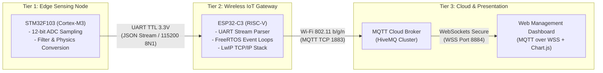
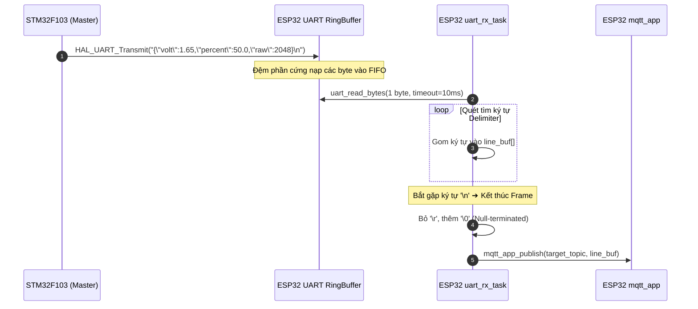
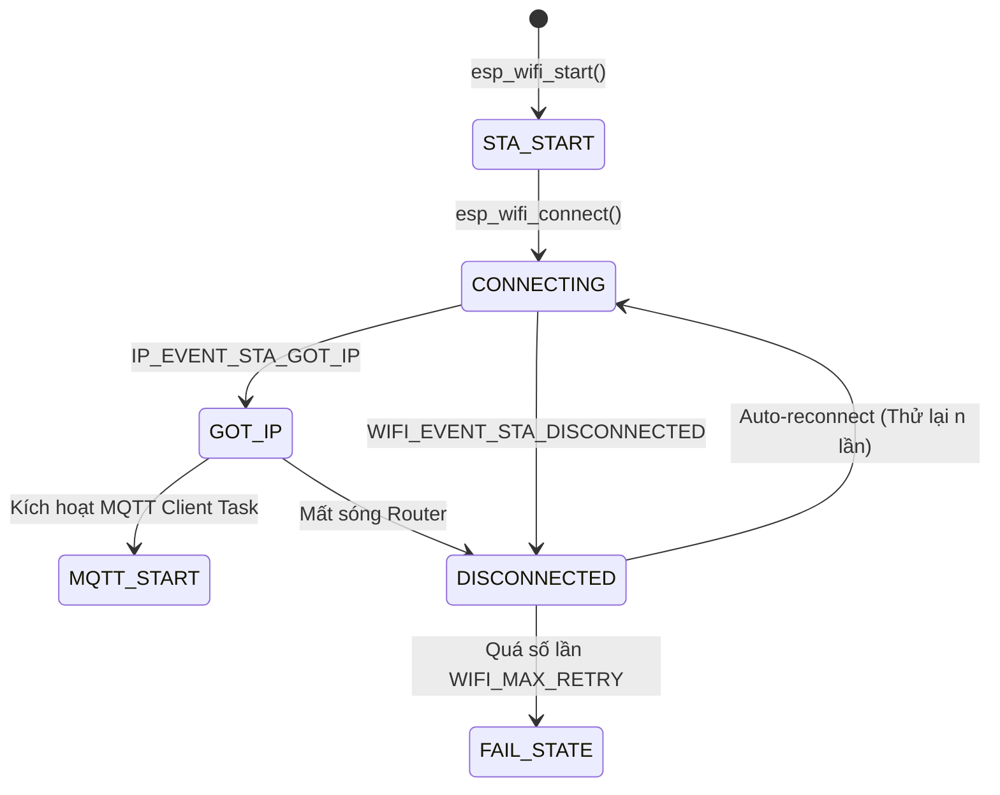
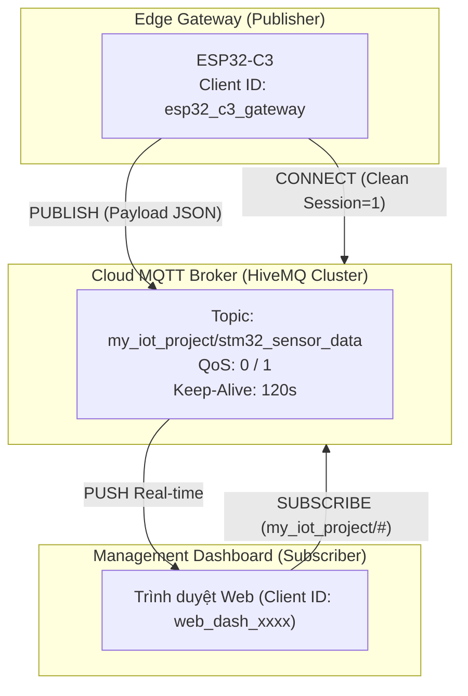
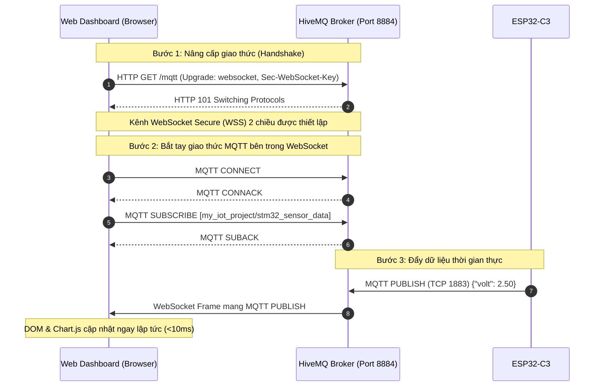

# BÁO CÁO KỸ THUẬT: KIẾN TRÚC MẠNG VÀ GIAO THỨC TRUYỀN THÔNG HỆ THỐNG IOT GATEWAY (STM32 & ESP32-C3)

---

## 1. TỔNG QUAN HỆ THỐNG VÀ PHÂN LỚP KIẾN TRÚC

Hệ thống được thiết kế theo mô hình **IoT Gateway phân cấp 3 tầng (Hierarchical 3-Tier IoT Architecture)** nhằm tối ưu hóa việc phân chia tài nguyên, đảm bảo tính thời gian thực (Real-time Determinism) và tách biệt hoàn toàn giữa tác vụ xử lý cảm biến và tác vụ mạng.



### Bảng phân tích trách nhiệm từng tầng

| Tầng | Thiết bị | Vai trò chính | Tại sao tách riêng? |
| :--- | :--- | :--- | :--- |
| **Tier 1: Edge Node** | **STM32F103C8T6** | Đọc cảm biến tương tự (ADC 12-bit), lọc nhiễu, chuyển đổi sang đại lượng vật lý (Volt, %). | Đảm bảo tính tiền định (Determinism), không bị trễ chu kỳ đọc do ngắt mạng hay bắt tay TCP/TLS. |
| **Tier 2: Gateway Node** | **ESP32-C3** | Gom gói tin UART, đệm dữ liệu, quản lý kết nối Wi-Fi Station và giao thức MQTT. | Gánh toàn bộ tải nặng của Stack mạng (LwIP, TCP, Crypto, Event-driven state machine) thay cho STM32. |
| **Tier 3: Cloud & UI** | **HiveMQ & Web Dashboard** | Điều phối bản tin qua cơ chế Pub/Sub, hiển thị dữ liệu thời gian thực trên đồ thị. | Cho phép giám sát từ xa mọi lúc mọi nơi mà không cần cài đặt phần mềm chuyên biệt. |

---

## 2. GIAO THỨC TẦNG THIẾT BỊ: STM32 ⟷ ESP32-C3 (UART + JSON FRAMING)



### 2.1. Tầng vật lý (Physical Layer)
* **Mức logic:** 3.3V TTL (Transistor-Transistor Logic). Cả hai chip đều hoạt động ở điện áp logic 3.3V, loại bỏ hoàn toàn nhu cầu về IC chuyển đổi mức (Logic Level Shifter).
* **Cấu hình truyền thông:** 
  - **Baud Rate:** `115200 bps` (thời gian truyền mỗi bit xấp xỉ $8.68\,\mu\text{s}$, truyền 1 byte mất $\approx 86.8\,\mu\text{s}$).
  - **Frame Format:** `8-N-1` (8 data bits, no parity bit, 1 stop bit).
  - **Đường truyền:** Bán song công/Song công đầy đủ thông qua 2 đường vi sai bất đối xứng (`TX` ➔ `RX`).

### 2.2. Đóng gói dữ liệu (Data Framing & Serialization)
Để giải quyết bài toán **Stream-to-Packet** (dữ liệu UART truyền theo dòng liên tục, dễ bị chia cắt thành nhiều khối rời rạc), hệ thống áp dụng kỹ thuật **Delimiter-based Framing**:

* **Ký tự giới hạn (Delimiter):** Ký tự xuống dòng `\n` (`0x0A` - LF).
* **Định dạng dữ liệu:** Chuỗi chuẩn **JSON (JavaScript Object Notation)**:
  ```json
  {"volt":2.45,"percent":74.3,"raw":3042}\n
  ```
* **Lý do chọn JSON có Delimiter:**
  1. *Tính toàn vẹn (Integrity):* ESP32 chỉ giải phóng gói tin lên tầng MQTT khi và chỉ khi đã thu thập đủ chuỗi và chạm tới ký tự `\n`.
  2. *Khả năng tương thích ngược (Backward Compatibility):* Dễ dàng bổ sung thêm trường dữ liệu (ví dụ: `temp`, `hum`, `status`) mà không làm vỡ cấu trúc parser ở Cloud.
  3. *Dễ gỡ lỗi (Human-readable):* Cho phép dùng mạch USB-TTL soi trực tiếp bằng Serial Monitor.

---

## 3. GIAO THỨC TẦNG MẠNG & TRUYỀN TẢI: WI-FI & TCP/IP



### 3.1. Wi-Fi Physical & MAC Layer
* **Chuẩn:** IEEE 802.11 b/g/n trên băng tần **2.4 GHz**.
* **Chế độ hoạt động:** **Station Mode (STA)** — ESP32-C3 đóng vai trò là một Node mạng con kết nối vào điểm truy cập (Access Point / Wi-Fi Router).
* **Bảo mật:** WPA2-PSK (AES/CCMP), cung cấp khả năng mã hóa đường truyền vô tuyến mạnh mẽ.

### 3.2. TCP/IP Stack (LwIP) & Event Management
* ESP-IDF tích hợp bộ ngăn xếp **LwIP (Lightweight IP)** mã nguồn mở được tối ưu hóa cho hệ thống nhúng.
* **Cơ chế Event-Driven (Hướng sự kiện):**
  - Hệ thống sử dụng `esp_event_loop` của FreeRTOS.
  - Các tác vụ mạng không sử dụng hàm chờ bận (`delay`/`busy-waiting`), mà đồng bộ hóa thông qua các **Event Bits** (`WIFI_CONNECTED_BIT`, `WIFI_FAIL_BIT`).
  - Khi mất sóng, callback `wifi_event_handler` tự động kích hoạt tiến trình kết nối lại (`auto-reconnect`) theo thuật toán lũy tiến, đảm bảo thiết bị không bị cô lập khi Router khởi động lại.

---

## 4. GIAO THỨC TẦNG ỨNG DỤNG: MQTT (MESSAGE QUEUING TELEMETRY TRANSPORT)



### 4.1. Bản chất của giao thức MQTT trong IoT
MQTT là giao thức mạng gọn nhẹ xây dựng trên tầng truyền tải TCP, hoạt động theo mô hình **Publish/Subscribe (Xuất bản / Đăng ký)**:

1. **Client ID:** Mỗi thiết bị định danh duy nhất (ESP32-C3 và Web Dashboard sở hữu 2 Client ID riêng biệt).
2. **Topic Hierarchy (Cấu trúc phân cấp kênh):**
   - Topic sử dụng dấu gạch chéo `/` để phân cấp chủ đề, ví dụ:
     `my_iot_project/stm32_sensor_data`
   - Phía Web Dashboard có thể đăng ký chính xác topic này hoặc đăng ký theo ký tự đại diện wildcard (`my_iot_project/+` hoặc `#`).
3. **Mức chất lượng dịch vụ (QoS - Quality of Service):**
   - **QoS 0 (At most once):** Bắn gói tin và không cần phản hồi ACK (nhanh nhất, phù hợp dữ liệu cảm biến định kỳ).
   - **QoS 1 (At least once):** Broker gửi lại gói `PUBACK`, đảm bảo dữ liệu tới đích ít nhất một lần (dùng trong project này).
   - **QoS 2 (Exactly once):** Bắt tay 4 bước đảm bảo không trùng lặp (tốn băng thông nhất).
4. **Cơ chế Keep-Alive & Ping:** Duy trì kết nối socket liên tục mà không cần thiết lập lại kết nối TCP. ESP32 gửi gói tin kiểm tra `PINGREQ` và nhận `PINGRESP` với kích thước chỉ **2 bytes**.

### 4.2. So sánh chuyên sâu: Tại sao chọn MQTT thay vì HTTP REST API?

| Đặc tính kỹ thuật | Giao thức MQTT (Lựa chọn của dự án) | Giao thức HTTP (REST API truyền thống) |
| :--- | :--- | :--- |
| **Mô hình truyền thông** | **Publish / Subscribe** (Bất đồng bộ, Event-driven) | **Request / Response** (Đồng bộ, Client hỏi - Server trả lời) |
| **Kích thước Header** | Cực kỳ nhỏ (**2 bytes** tối thiểu) | Rất lớn (**nhiều trăm bytes** cho HTTP headers/cookies) |
| **Duy trì kết nối** | **Persistent Socket** (Bắt tay 1 lần, giữ socket mở) | **Stateless** (Phải bắt tay TCP + TLS lại ở mỗi request) |
| **Độ trễ truyền tải** | **Real-time (< 20ms)** khi socket đã mở | **Cao (100ms - 500ms)** do phụ thuộc độ trễ thiết lập phiên |
| **Truyền dữ liệu xuống (Downlink)**| **Server đẩy trực tiếp (Push)** xuống thiết bị ngay lập tức | Thiết bị phải liên tục hỏi vòng (**Polling**), gây lãng phí băng thông |
| **Tiêu thụ RAM & Năng lượng** | Rất thấp, phù hợp với vi điều khiển nhúng | Cao, dễ gây phân mảnh bộ nhớ Heap của ESP32 |

---

## 5. GIAO THỨC TẦNG TRÌNH DIỄN: MQTT OVER WEBSOCKETS (WSS)

Trình duyệt web vì lý do bảo mật hộp cát (Browser Sandbox Security) **không thể mở kết nối TCP Socket thuần (Raw TCP Port 1883)**. Để Web Dashboard nhận được dữ liệu thời gian thực mà không cần cài thêm Web Server trung gian, hệ thống áp dụng kỹ thuật **MQTT over WebSocket**.



* **Cổng giao tiếp:** Cổng bảo mật `8884` (WSS - WebSocket Secure với chứng chỉ TLS/SSL).
* **Cơ chế hoạt động:** Gói tin MQTT nhị phân được bọc bên trong các **Frame WebSocket**. Trình duyệt sử dụng thư viện `mqtt.min.js` để giải mã frame và kích hoạt sự kiện `client.on('message', ...)` cập nhật thẳng vào đồ thị Chart.js.

---

## 6. ĐÁNH GIÁ ĐỘ TIN CẬY VÀ ĐỊNH HƯỚNG BẢO MẬT (ROADMAP)

> [!NOTE]
> **Tính năng chịu lỗi (Fault-Tolerance):**
> 1. Khi mất kết nối Wi-Fi hoặc Cloud Broker bị quá tải, tác vụ `uart_rx_task` và phần cứng STM32 vẫn hoạt động bình thường, không bao giờ bị nghẽn (Blocking).
> 2. Cơ chế phục hồi của ESP-IDF tự động quét lại Wi-Fi và tái thiết lập phiên MQTT (`Clean Session`) mà không yêu cầu người dùng phải khởi động lại phần cứng.

> [!TIP]
> **Lộ trình nâng cấp Bảo mật (Security Hardening):**
> - **Chuyển đổi sang MQTTS (Port 8883):** Tích hợp chứng chỉ CA vào firmware ESP32-C3 để mã hóa toàn bộ dữ liệu từ ESP32 lên Broker bằng chuẩn **TLS 1.2 / TLS 1.3**.
> - **Tăng tốc phần cứng (Hardware Crypto):** ESP32-C3 tích hợp sẵn các bộ gia tốc phần cứng cho mã hóa AES, SHA, và thuật toán chữ ký số RSA/ECC, giúp thực thi mã hóa TLS mà không làm suy giảm hiệu năng CPU.
> - **Xác thực 2 chiều (mTLS):** Cấp phát chứng chỉ riêng cho từng thiết bị để ngăn chặn các thiết bị giả mạo gửi dữ liệu rác lên Broker.
